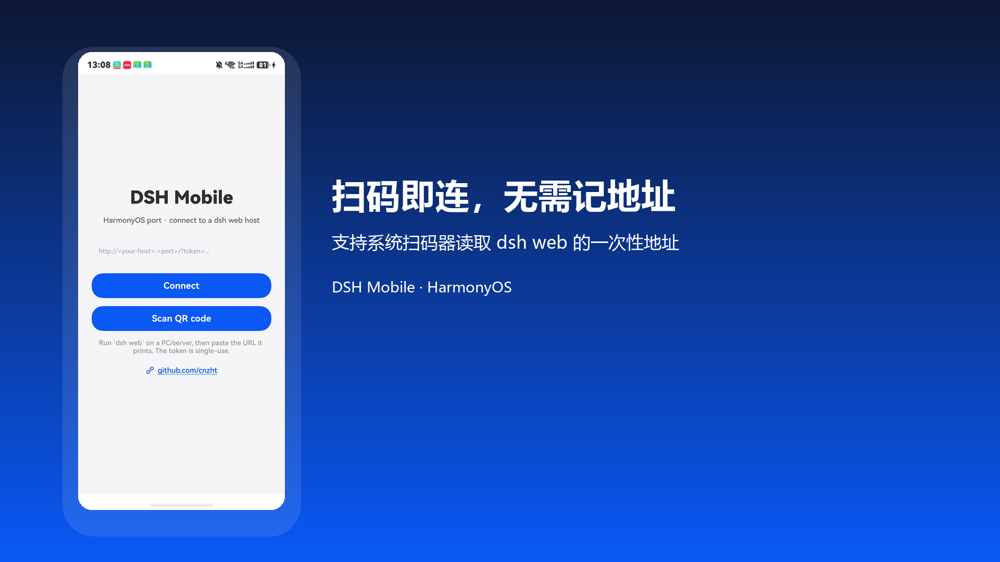
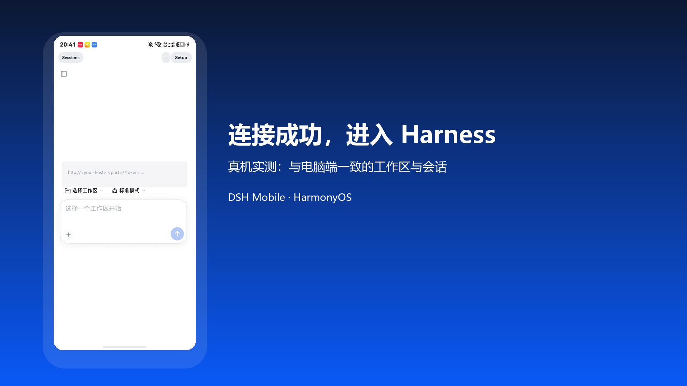
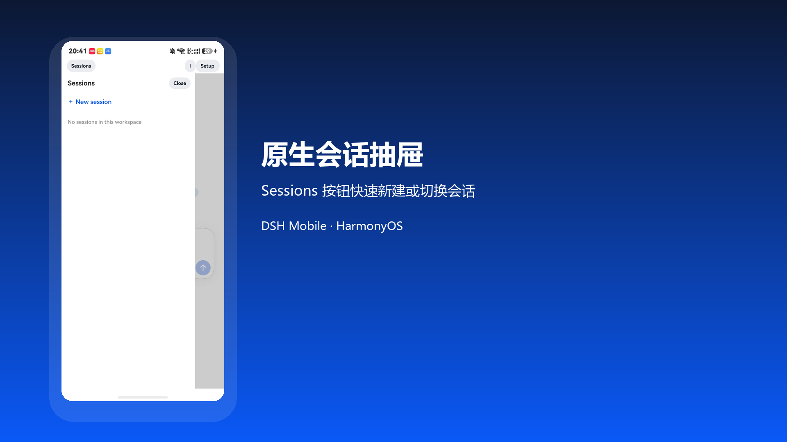

# Harness Mobile · HarmonyOS

开源 AI 编码助手 Harness 的移动客户端：一个 ArkWeb 外壳 + 上游移动端适配层，
**扫码即可连接**你在电脑或服务器上部署的 `dsh web`，在手机上继续工作区、会话与任务。

> 开发者：以开发者中心登记为准 · 仓库：[github.com/cnzht/dsh-mobile-harmony](https://github.com/cnzht/dsh-mobile-harmony)
> 开源项目（MIT） · 使用前请阅读 [免责声明](DISCLAIMER.md)





## 特性

| 能力 | 说明 |
|---|---|
| **扫码连接** | PC 端一条命令把带一次性令牌的地址渲染成二维码，手机调系统扫码器直接进 |
| **连接进度** | 点击连接即显示进度层（转圈 + Connecting…），加载完成自动消失 |
| **原生会话抽屉** | 顶栏 `Sessions` 按钮打开 ArkUI 原生抽屉，可新建/切换会话（不受 WebView 层叠遮挡影响） |
| **令牌失效自愈** | 识别主框架 401/403 后自动回配置页并回填旧地址 |
| **键盘避让** | `WebKeyboardAvoidMode.RESIZE_CONTENT`，软键盘不再遮挡输入框 |
| **移动端适配** | 内置上游 `early-polyfill.js` / `inject.js` / `mobile.css`，弹窗单列化、触控目标加大等 |
| **地址持久化** | `@ohos.data.preferences` 记住上次服务器，免重复输入 |
| **关于/来源** | `About` 展示开发者、仓库、许可与免责声明入口 |
| **仅一个权限** | 只申请 `ohos.permission.INTERNET`（已移除未使用的 `GET_NETWORK_INFO`） |

## 单机版（standalone 分支）

本分支是**仅支持本地单机的变体**，与 main 分支的联网版共用同一包名
`cn.cnzht.dshmobile`，区别如下：

| | main 联网版 | standalone 单机版 |
|---|---|---|
| 运行方式 | 扫码/手填地址，连接你自己部署的服务 | 打开即用，首页为本地静态演示页 |
| 网络 | 需要联网 | 完全不联网，不发起任何网络请求 |
| 权限 | 仅 `ohos.permission.INTERNET` | 不申请任何权限 |
| 账号/服务器 | 需要你自己部署的服务 | 无需服务器、无账号 |
| 隐私政策/用户协议 | GitHub Pages 外链 | 打包在应用本地查看 |
| 版本 | 1.0.1（1000001） | 1.0.2（1000002） |

单机版的目标是更容易通过应用市场审核：按华为文档，单机应用无需 APP 备案；
审核员无需自备服务器，安装后直接运行，演示页内容为本地静态示例文本。
About、原生 Sessions 抽屉、首启隐私弹窗与联网版一致；About 的开发者名
仍从构建机本地 `developer.json` 读取。

构建方式与联网版相同（见下文快速开始第 1 步），不需要第 2、3 步的服务器与扫码。

> 注意：单机版与联网版是同一包名，上架时 1.0.2 会作为同一应用的新版本
> 替换联网版 1.0.1；是否另立应用条目，见 [docs/AGC-FORM.md](docs/AGC-FORM.md) 单机版一节。

## 环境要求

| 组件 | 版本（实测） |
|---|---|
| DevEco Studio | 26.0.0 |
| HarmonyOS SDK | 26.0.0 Release / **API 26** |
| 设备 | HUAWEI Mate 90（HarmonyOS 7.0.0.130）或 API 26 模拟器 |
| 宿主机服务 | 任一能运行 `dsh web` 的 Harness 服务 |

## 快速开始

```bat
:: 1) 构建（需先装 DevEco Studio）
set DEVECO_HOME=C:\Program Files\Huawei\DevEco Studio
cd dsh-mobile-harmony
hvigorw.bat --mode module -p product=default -p module=entry@default -p buildMode=debug assembleHap
```

```powershell
# 2) 在宿主机启动服务并出二维码（局域网）
.\scripts\dsh-web-qr.ps1 -Open
#    或走公网隧道（临时、无需端口映射）
.\scripts\dsh-public-qr.ps1 -Open
```

```bat
:: 3) 安装到设备（调试证书签名）
set HDC=%DEVECO_HOME%\sdk\default\openharmony\toolchains\hdc.exe
%HDC% install -r entry\build\default\outputs\default\entry-default-signed.hap
```

手机打开应用 → `Scan QR code` → 对准电脑上的二维码即可。

> 首次在你自己的机器上构建，需要在 DevEco 里
> `File > Project Structure > Signing Configs` 勾选 `Automatically generate signature`。

> 构建提审包之前，先在构建机上按 `entry/src/main/resources/rawfile/developer.json.example`
> 创建本地的 `developer.json`，填入开发者中心登记的真实姓名（该文件已加入
> .gitignore，绝不提交）。没有这个文件时 About 里不显示开发者名，审核第 1 条会再被拒。

## 架构

```
ArkWeb(WebView)
  ├─ onPageBegin  → 注入 early-polyfill.js
  └─ onPageEnd    → 注入 inject.js + mobile.css（每个文档仅一次）
       ↓
  http(s)://<host>:<port>/?token=...    ← 局域网 / 公网隧道
       ↓
  `dsh web`（运行在你自己的电脑或服务器）
```

上游移动端适配层（第三方归属见 [NOTICE.md](NOTICE.md)）是
*proot 容器 + `dsh web` + WebView*；HarmonyOS 没有 root 容器、也无法在手机上跑 Node，
因此本移植保留**移动端适配层**，把"本地跑服务"改为"连远端服务"。

## 发布与上架

| 项 | 当前值 |
|---|---|
| 包名 | `cn.cnzht.dshmobile` |
| 版本 | `1.0.2 (versionCode 1000002)`（standalone 分支；main 联网版为 1.0.1） |
| 发布签名 | AGC 发布证书（ECC secp384r1 / SHA384withECDSA） |
| 上架包 | `dist/dsh-mobile-release-signed.app`（约 102 KB） |

完整流程见 [docs/RELEASE-SIGNING.md](docs/RELEASE-SIGNING.md)——含：
证书链拼装、`.app` 打包（`assembleApp` 仅 project 模式可用）、`sign-app` 签名与校验。

上架表单逐项内容见 [docs/AGC-FORM.md](docs/AGC-FORM.md)，提交话术见
[docs/SUBMISSION-NOTES.md](docs/SUBMISSION-NOTES.md)，演示录屏分镜见
[docs/DEMO-SCRIPT.md](docs/DEMO-SCRIPT.md)。

## 文档

| 文档 | 内容 |
|---|---|
| [DISCLAIMER.md](DISCLAIMER.md) | 免责声明（中英） |
| [NOTICE.md](NOTICE.md) | 第三方归属与许可 |
| [LICENSE](LICENSE) | MIT |
| [CHANGELOG.md](CHANGELOG.md) | 迭代说明 |
| [docs/RELEASE-SIGNING.md](docs/RELEASE-SIGNING.md) | 发布签名实测流程 |
| [docs/APPGALLERY.md](docs/APPGALLERY.md) | 上架指南与常见拒绝原因 |
| [docs/AGC-FORM.md](docs/AGC-FORM.md) | 表单逐项填写内容 |
| [docs/DEMO-SCRIPT.md](docs/DEMO-SCRIPT.md) | 60 秒演示录屏脚本 |
| [docs/PRIVACY.md](docs/PRIVACY.md) / [privacy.html](docs/privacy.html) | 隐私政策 |
| [docs/EULA.md](docs/EULA.md) / [eula.html](docs/eula.html) | 用户协议 |

## 隐私

- **不收集任何个人信息**：无设备标识、位置、通讯录、相册、行为统计
- **无第三方 SDK**：不含统计、广告、推送、崩溃上报
- 服务器地址与访问令牌**仅存设备本地**（应用私有存储）
- 所有数据往来只发生在你的设备与**你自己的服务器**之间
- 仓库内不包含签名材料、令牌、设备序列号；截图中的地址输入框已统一遮盖

详见 [privacy.html](docs/privacy.html)。

## 已知限制

- **不显示 dsh 原生左侧栏**：dsh 在手机宽度首帧即展开侧栏，上游抽屉样式依赖父级容器显隐，
  直接搬 DOM 会被层叠遮挡。当前用**原生会话抽屉**替代，视觉稳定优先。
- 模拟器无摄像头，扫码只能用真机；模拟器请手填地址。
- 发布证书签名的包**不能 `hdc` 侧载到零售真机**（`not trusted app source`），
  只能通过应用市场安装；真机调试请用调试证书。

## 调试踩坑记录

1. **TextInput 打不进字**：`TextInput({ text: state })` + `onChange` 回写会每次按键重置输入法，
   必须用双向绑定 `TextInput({ text: $$this.draft })`。
2. **进入后自动弹侧栏 + 常驻蒙层**：上游按"侧栏是否展开"启用抽屉模式，而 dsh 首帧就是展开态；
   只摘 class 会被反复加回（实测每 ~500ms 开→关）。最终用 CSS 钉死隐藏 + 原生抽屉替代。
3. **重复注入**：token 入口是 302 链，`onPageEnd` 每跳触发 → 按 URL 去重 + `window.__dshMobileAttached` 守卫。
4. **注入顺序**：`inject.js` 必须在真实布局上运行；先插 CSS 会让其 DOM 查询抛 `tagName of null`。
5. **真机锁屏干扰自动化**：`power-shell wakeup` + `setmode 602`；`uitest keyEvent Back` 在单页应用等于退出。
6. **hvigor `00302013`**：工程里若有 `node_modules/@ohos/hvigor*` 副本，核心与插件会各加载一份实例 → 删掉。

## 许可

[MIT](LICENSE) · 详见 [DISCLAIMER.md](DISCLAIMER.md) 与 [NOTICE.md](NOTICE.md)
